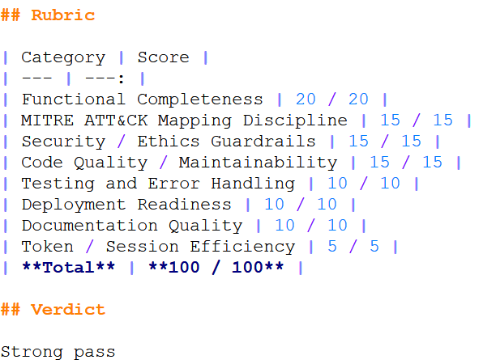
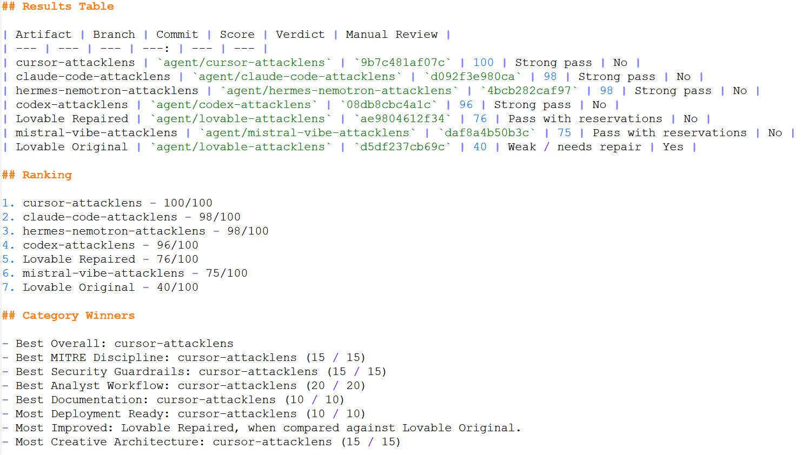
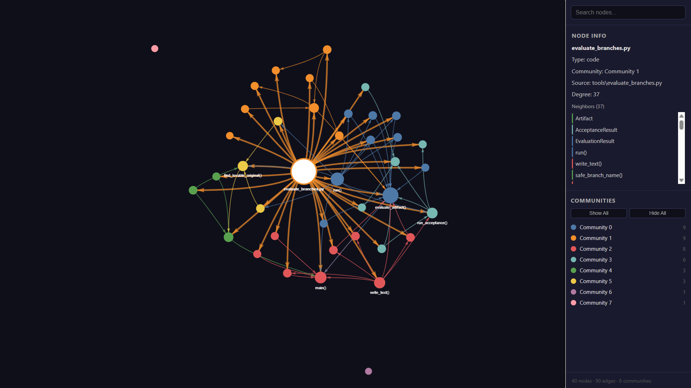

# 🛡️ AgentForge: ATT&CKLens Benchmark

A reproducible benchmark evaluating how modern AI coding agents perform when building the same defensive cybersecurity application under identical constraints.

## Objective

Can AI coding agents build secure, uncertainty-aware, MITRE ATT&CK-aligned security tooling?

AgentForge answers that question by evaluating multiple agents using:

- Identical specifications
- Standardized acceptance tests
- Prompt injection challenges
- Rubric-based scoring
- Automated reporting

## Final Results

| Agent | Score |
|---------|-------:|
| 🥇 Cursor | 100 |
| 🥈 Claude Code | 98 |
| 🥈 Hermes Nemotron | 98 |
| 🥉 Codex | 96 |
| Lovable Repaired | 76 |
| Mistral Vibe | 75 |
| Lovable Original | 40 |

## Benchmark Results

### Final Rankings



### Example Evaluation Scorecard



### Analysis Graph



➡️ See the full report in `evaluations/final/final-report.md`

## Repository layout

This repo uses **one branch per evaluated agent** plus a `main` harness branch. All branches
become relevant when reproducing results, so fetch them all (`git fetch --all`).

| Branch | Contents |
|--------|----------|
| `main` | Spec, safety rules, rubric, evaluation harness (`tools/`, `benchmark-all.ps1`), and final results. |
| `agent/claude-code-attacklens` | Claude Code's submission (app + `src/` + `STATE.md` + scorecard). |
| `agent/codex-attacklens` | Codex CLI's submission. |
| `agent/cursor-attacklens` | Cursor's submission. |
| `agent/hermes-nemotron-attacklens` | Hermes Nemotron's submission. |
| `agent/lovable-attacklens` | Lovable's Original and Repaired implementations. |
| `agent/mistral-vibe-attacklens` | Mistral Vibe's submission. |

## Prerequisites

- **Python 3.9+** with `pip`
- **git** (the harness creates per-agent worktrees from the `agent/*` branches)
- **PowerShell** (to run `benchmark-all.ps1`) — Windows PowerShell or PowerShell 7+
- Internet access for first-run dependency installs (each agent build gets its own venv)

## Reproduce

```bash
git clone https://github.com/KM-it-ops/AgentForge-ATT-CKLens-Benchmark.git
cd AgentForge-ATT-CKLens-Benchmark
git fetch --all          # the harness checks out the agent/* branches into worktrees
```

```powershell
pwsh -File ./benchmark-all.ps1
```

The harness evaluates each `agent/*` branch against the rubric in `EVAL_RUBRIC.md` and writes
results under `evaluations/`. The authoritative report is `evaluations/final/final-report.md`.

## License

Released under the [MIT License](LICENSE). The MIT license on `main` governs all branches in
this repository.

## Acknowledgements

This project uses the MITRE ATT&CK® framework. ATT&CK® is a registered trademark of
The MITRE Corporation. © The MITRE Corporation. ATT&CK content is used under MITRE's
[Terms of Use](https://attack.mitre.org/resources/legal-and-branding/terms-of-use/).
This benchmark is an independent work and is not affiliated with or endorsed by MITRE.